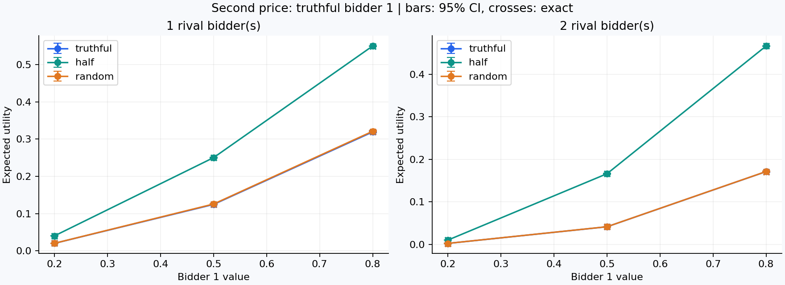
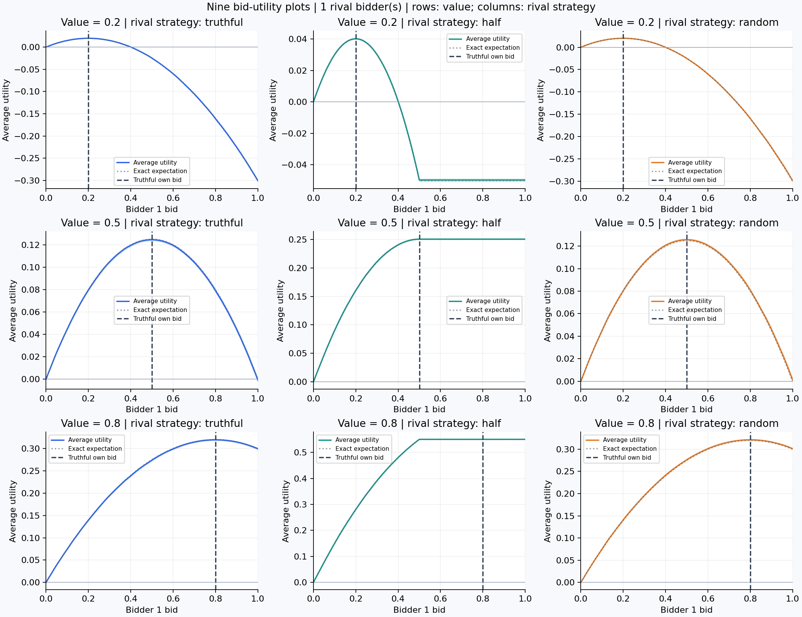
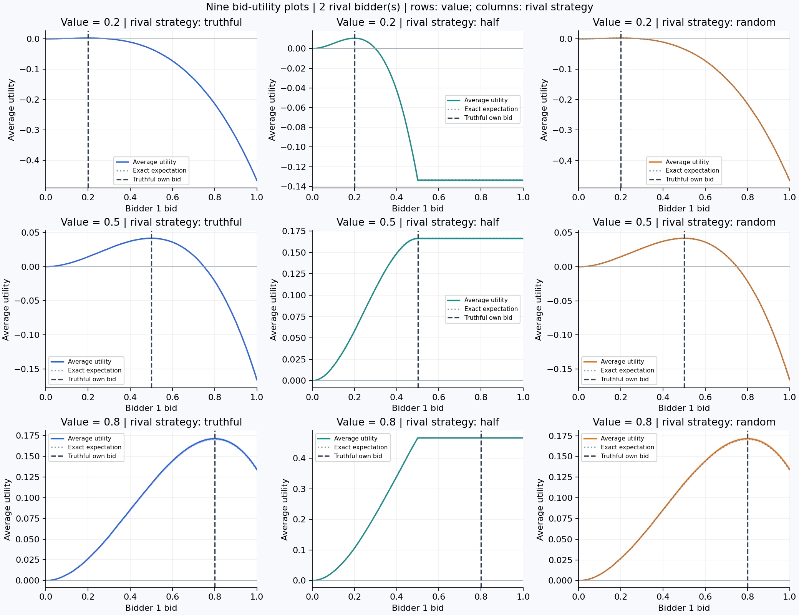
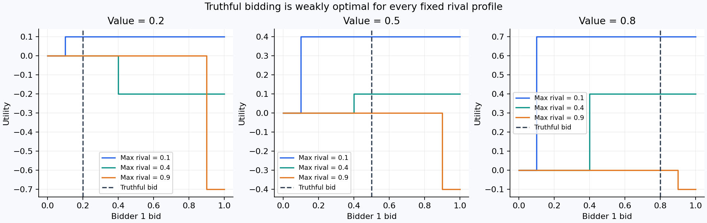
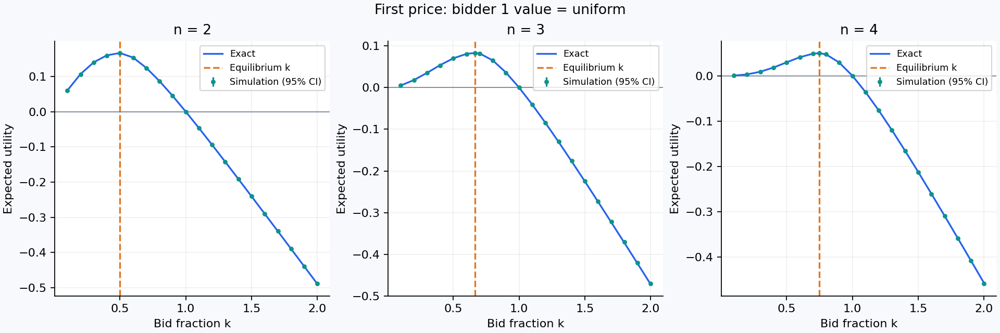
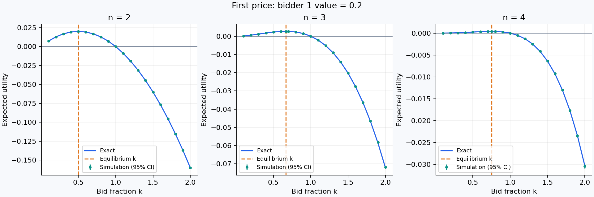
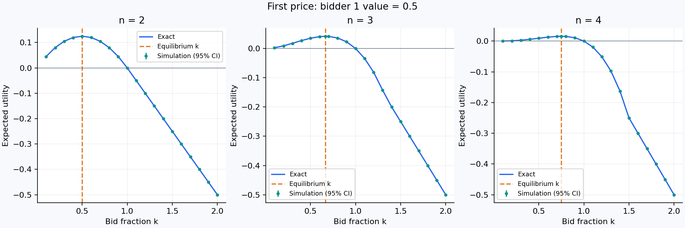
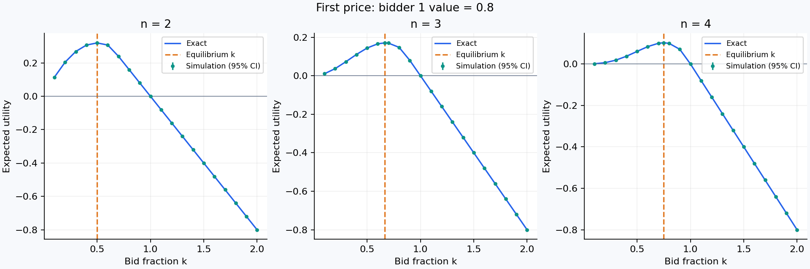
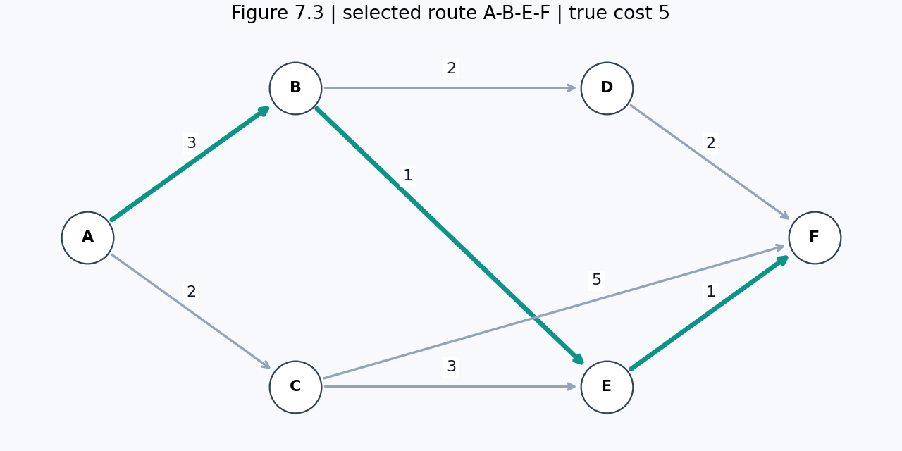
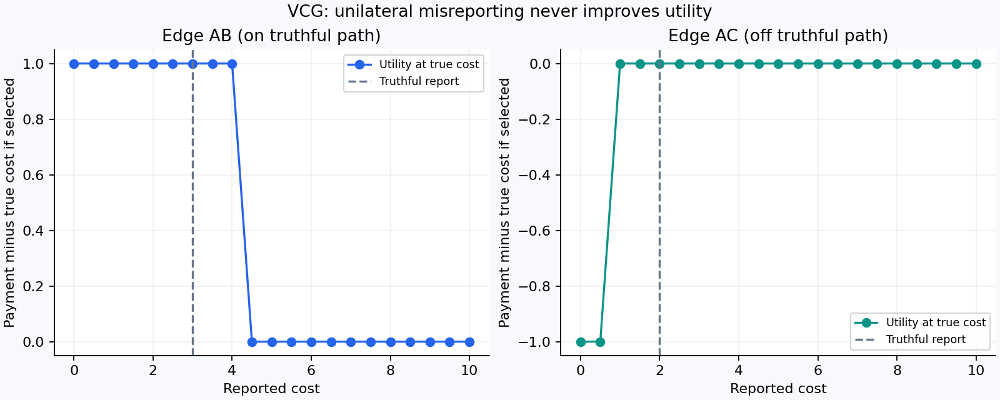

# Autonomous Systems: Auctions and VCG

## Experimental design and assumptions

Seed: 42. Monte Carlo trials per configuration: 100,000. Values and bids are continuous, independently uniform on [0,1] wherever specified. Utilities are risk neutral and quasilinear. Ties go to the lowest bidder index (bidder 1); VCG path ties are lexical. Losing bidders pay zero. All experiments use reproducible NumPy generators; first-price k comparisons share valuation draws. Confidence intervals are normal-approximation 95% Monte Carlo intervals, not guarantees. Exact expectations are included separately.

The prompt's repeated 'parts A and C' is interpreted as repeating both random-rival and fixed-rival experiments with two rivals. Two-rival fixed checks cover all nine ordered pairs from {0.1,0.4,0.9}. Part 2 does not specify bidder 1's value, so it includes all three Part 1 values and a separate ex ante U[0,1] experiment. The required k grid is 0.1,0.2,...,2.0; exact equilibrium points are additional reference rows.

## Part 1: second-price sealed-bid auction

Bidder 1 bids b=v. With M the highest rival bid, u=(v-M) when b>=M and zero otherwise. Random rival bids are drawn independently of their true values. Both rivals use the same strategy but independent draws.

For m rivals with bids U[0,s], let x=min(v/s,1). Then E[u]=v*x^m - s*m/(m+1)*x^(m+1). Here s=1 for truthful and random bidding, and s=0.5 for half bidding. Truthful and random rival strategies therefore have identical expected outcomes, although individual simulations differ.

| rivals | value | strategy | mean_utility | standard_error | exact_utility | win_fraction |
|---|---|---|---|---|---|---|
| 1 | 0.200000 | truthful | 0.019955 | 0.000151 | 0.020000 | 0.199210 |
| 1 | 0.500000 | truthful | 0.124567 | 0.000510 | 0.125000 | 0.497430 |
| 1 | 0.800000 | truthful | 0.319375 | 0.000826 | 0.320000 | 0.800810 |
| 1 | 0.200000 | half | 0.040118 | 0.000193 | 0.040000 | 0.401450 |
| 1 | 0.500000 | half | 0.250333 | 0.000457 | 0.250000 | 1.000000 |
| 1 | 0.800000 | half | 0.550333 | 0.000457 | 0.550000 | 1.000000 |
| 1 | 0.200000 | random | 0.020104 | 0.000151 | 0.020000 | 0.201060 |
| 1 | 0.500000 | random | 0.125617 | 0.000511 | 0.125000 | 0.501840 |
| 1 | 0.800000 | random | 0.321115 | 0.000826 | 0.320000 | 0.800690 |
| 2 | 0.200000 | truthful | 0.002619 | 0.000050 | 0.002667 | 0.039590 |
| 2 | 0.500000 | truthful | 0.041677 | 0.000294 | 0.041667 | 0.250540 |
| 2 | 0.800000 | truthful | 0.171260 | 0.000625 | 0.170667 | 0.641360 |
| 2 | 0.200000 | half | 0.010521 | 0.000097 | 0.010667 | 0.158460 |
| 2 | 0.500000 | half | 0.166319 | 0.000372 | 0.166667 | 1.000000 |
| 2 | 0.800000 | half | 0.466319 | 0.000372 | 0.466667 | 1.000000 |
| 2 | 0.200000 | random | 0.002665 | 0.000051 | 0.002667 | 0.040470 |
| 2 | 0.500000 | random | 0.041816 | 0.000295 | 0.041667 | 0.252460 |
| 2 | 0.800000 | random | 0.171440 | 0.000626 | 0.170667 | 0.642060 |

### Part A: sweep every own bid for each value and rival strategy

Bidder 1 tries every required grid bid 0,0.01,...,1 for each value and strategy, with one and two rivals: 1,818 rows in second_price_bids.csv. There are nine separate plots for Part A: each fixed value paired with each rival strategy. Each bid is evaluated over 100,000 auctions. All candidate bids share rival draws within a scenario, making comparisons paired. Utility is (v-M) if the candidate bid wins and zero otherwise; negative utility from overbidding is retained.

For arbitrary own bid b, the exact expectation uses x=min(b/s,1) in E[u]=v*x^m - s*m/(m+1)*x^(m+1). The truthful b=v is a maximizing grid bid in every scenario: **True**. Other bids may tie under the sampled draws; half-bidding rivals also create a population plateau for v>=0.5 once b>=0.5. The truthful-only table above is retained as a compact benchmark.

Individual Part A figures are in [part1a/](part1a/): filenames value_0.2_truthful.png through value_0.8_random.png cover all nine combinations.

Individual two-rival figures are in [part1c/](part1c/), with the same nine value/strategy combinations. Both rivals use the same strategy and independent value and bid draws.

### Fixed rival bids and dominant strategy

The bid sweep uses b=0,0.01,...,1 and includes each truthful value exactly. Every one- and two-rival profile passes: **True**. See fixed_bids.csv for all 3,636 rows.

For any fixed rivals, only M matters. If v>M, every b>=M yields v-M>0 and losing yields zero. If v<M, losing yields zero and winning yields a negative utility. If v=M, utility is zero either way. Thus b=v is weakly optimal over all nonnegative bids, beyond the numerical grid. It need not be the unique maximizing bid.

## Part 2: first-price auction

For n bidders, rivals bid a*w where a=(n-1)/n and w~U[0,1]. Bidder 1 bids k*v and pays its own bid if it wins. The conditional exact utility is (1-k)*v*min(k*v/a,1)^(n-1). The ex ante result integrates this expression over v~U[0,1]. Bids above value can generate negative utility; these observations are retained.

Best required-grid points by exact expected utility (Monte Carlo estimates are shown alongside):

| n | value | k | mean_utility | exact_utility |
|---|---|---|---|---|
| 2 | 0.2 | 0.500000 | 0.019921 | 0.020000 |
| 2 | 0.5 | 0.500000 | 0.124357 | 0.125000 |
| 2 | 0.8 | 0.500000 | 0.320324 | 0.320000 |
| 2 | uniform | 0.500000 | 0.165877 | 0.166667 |
| 3 | 0.2 | 0.700000 | 0.002600 | 0.002646 |
| 3 | 0.5 | 0.700000 | 0.041199 | 0.041344 |
| 3 | 0.8 | 0.700000 | 0.169778 | 0.169344 |
| 3 | uniform | 0.700000 | 0.081467 | 0.081973 |
| 4 | 0.2 | 0.700000 | 0.000383 | 0.000390 |
| 4 | 0.5 | 0.700000 | 0.015264 | 0.015244 |
| 4 | 0.8 | 0.700000 | 0.099514 | 0.099906 |
| 4 | uniform | 0.700000 | 0.049034 | 0.048782 |

The theoretical equilibrium fractions are 0.5, 2/3, and 0.75. The latter two are not on the required 0.1 grid; extra reference rows avoid mistaking grid discretization for a profitable deviation. For high fixed v there can also be a plateau in win probability once a bid exceeds the largest possible rival bid. Exact expectations, rather than a noisy empirical argmax, establish the grid optimum.

### Could the winner have paid less?

For every auction, identify the winner among ALL n bidders and calculate the winning bid minus the second-highest bid. A strictly positive gap means there exists a smaller bid that still wins. With continuous independent draws this occurs with probability 1: the measured fraction is 1.000000 to 1.000000 across configurations. This is an ex post observation with hindsight, not a contradiction of Bayesian equilibrium. The gap is the supremum saving; a strict win requires saving less than the gap. CSVs also report the average gap and the fraction able to reduce payment by 0.01 and still strictly win.

## Part 3: VCG cheapest-path procurement

Source: attached book, Figure 7.3, printed page 300 / PDF page 349. The graph is directed: AB=3, AC=2, BD=2, BE=1, CE=3, CF=5, DF=2, EF=1. Dijkstra selects **ABEF**, total true cost **5**.

For selected edge e, payment TO the edge is C_without_e - (C_selected - reported_cost_e). Unselected edges receive zero. This payment-to-agent convention reverses the sign of the book's payment-from-agent notation. Utilities always subtract the TRUE cost, even when the reported cost differs.

| edge | true_cost | selected | payment | utility |
|---|---|---|---|---|
| AB | 3.000000 | True | 4.000000 | 1.000000 |
| AC | 2.000000 | False | 0.000000 | 0.000000 |
| BD | 2.000000 | False | 0.000000 | 0.000000 |
| BE | 1.000000 | True | 2.000000 | 1.000000 |
| CE | 3.000000 | False | 0.000000 | 0.000000 |
| CF | 5.000000 | False | 0.000000 | 0.000000 |
| DF | 2.000000 | False | 0.000000 | 0.000000 |
| EF | 1.000000 | True | 3.000000 | 2.000000 |

Removing AB gives ACEF of cost 6, so AB receives 6-(5-3)=4. Removing BE gives ACEF of cost 6, so BE receives 6-(5-1)=2. Removing EF gives ABDF of cost 7, so EF receives 7-(5-1)=3. Total procurement payment is 9; this differs from the path's true cost 5.

### Misreport sweep

AB (on the truthful path) and AC (off it) each report 0,0.5,...,10, holding all other reports truthful: 42 deviations total. AB's true cost remains 3 and AC's remains 2. AB receives utility 1 while selected (reports through 4 under lexical tie breaking), then 0 when excluded. AC can enter by underreporting (reports 0 and 0.5; at 1 the lexical tie favors ABEF), but receives payment 1 against true cost 2 and loses utility 1; otherwise its utility is zero. Neither gains from deviating. Truthfulness is weakly dominant, so some deviations tie it.

## Validation

| check | passed |
|---|---|
| all_fixed_profiles_truthful_optimal | True |
| all_random_rival_bid_sweeps_truthful_optimal | True |
| second_price_bid_sweeps_within_mc_tolerance | True |
| vcg_path_ABEF | True |
| vcg_payments_match_book | True |
| no_profitable_vcg_deviations | True |
| second_price_within_mc_tolerance | True |
| first_price_within_mc_tolerance | True |

Run `python -m pytest -q` (or `./run.ps1 test` in the prepared Windows environment) for unit, property, batch CLI, and web-export tests. These validation flags concern the generated simulation run; the test suite is separate. Numerical validation uses tolerance 6*SE + 36/N, with the bounded-sample correction protecting rare-event cases where no wins were sampled and empirical SE is zero. This differs from the displayed normal 95% confidence intervals, which can be unreliable for rare events. CSVs contain full precision; plots and report tables round for readability. No claim of real-world bidder behavior is made: conclusions apply to the specified independent-uniform private-value models.
